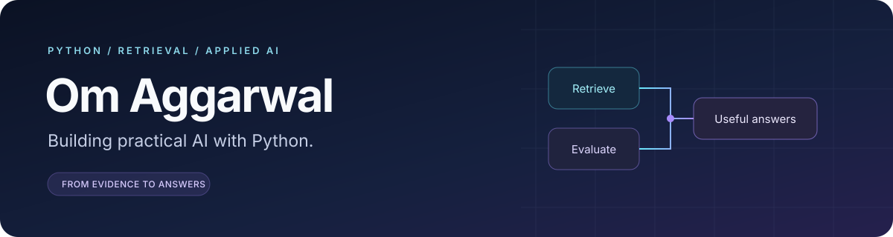

  

I build AI applications that turn documents, conversations, and domain data into
useful answers. My projects focus on **retrieval-augmented generation**, **LangGraph
workflows**, and interfaces that make them easy to use.

  
  
  
  
  

### Featured projects

| Project | What I built | Focus |
| :--- | :--- | :--- |
| **[Self-Healing RAG](https://github.com/omagg/self-healing-rag)** | Document Q&A with corrective retrieval, HyDE, reranking, optional web recovery, and an answer quality scorecard. | LangGraph · Groq · Streamlit |
| **[RestroBot](https://github.com/omagg/RestroBot)** | A restaurant-menu assistant combining dense and keyword retrieval, reciprocal rank fusion, cross-encoder reranking, and conversation memory. | FAISS · BM25 · Flask · React |
| **[LangGraph Chatbot](https://github.com/omagg/Langgraph-Chatbot)** | A conversational app built around graph-based conversation state and a Streamlit chat interface. | LangGraph · LangChain · Groq |
| **[YouTube RAG Chatbot](https://github.com/omagg/Youtube-Chatbot)** | A chatbot that retrieves relevant passages from English video transcripts to answer questions about a video. | Hugging Face · FAISS · Streamlit |

### What I work with

| Area | Tools and techniques |
| :--- | :--- |
| **AI applications** | Python, LangChain, LangGraph, Groq, Gemini |
| **Retrieval** | Local embeddings, FAISS, BM25, hybrid search, HyDE, cross-encoder reranking |
| **Evaluation** | Precision@5, Recall@5, MRR@5, LLM-judged correctness and faithfulness, response time |
| **Interfaces** | Streamlit, Flask, React, Vite |

### What I care about

- **Better evidence:** checking relevance and improving retrieval before generating an answer.
- **Measurable behavior:** comparing baseline and enhanced pipelines, with failures and limitations visible.
- **Usable applications:** connecting the retrieval pipeline to a clear document or chat workflow.

My Self-Healing RAG project includes a reproducible comparison on **20 curated
questions across two configurations**. You can read the
[recorded results and their limitations](https://github.com/omagg/self-healing-rag/blob/main/backend/evaluation/example_summary.md)
alongside the implementation.

---

  <a href="https://github.com/omagg?tab=repositories">Explore my repositories →</a>

